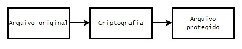
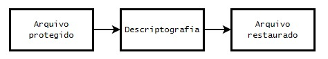

# Python Cryptography and Security Lab

<p align="center">
  
</p>

## 📌 Project Overview

This project aims to demonstrate fundamental concepts of cryptography, software behavior analysis, and information security using Python in a controlled, educational environment.

The experiments include a simulated ransomware scenario designed to explore file encryption and recovery processes, as well as a secure local system inventory module that demonstrates how software collects and records system metadata.

The project consists of two main simulations:

### 1. **Simulated Ransomware**

* Creation of test files for controlled experiments;
* Local file encryption and decryption;
* Display of a simulated ransom message.

### 2. **Secure Data Collection Simulation**

* Local collection of system environment information;
* Generation of a report for auditing and analysis purposes;
* Demonstration of how software retrieves system metadata.

> **Disclaimer:** This project is intended exclusively for educational purposes and must only be executed in an isolated, controlled environment.
>
> Developed as a practical project inspired by the Santander 2025 Cybersecurity Bootcamp.

---

# Project Structure

```text
python-security-lab/
│
├── assets/
│   ├── ransomware_encrypt.py
│   ├── ransomware_decrypt.py
│   ├── ransom_message.py
│   ├── data_inventory.py
│   │
│   ├── test_files/
│   │   └── test.txt
│   │
│   └── logs/
│       └── inventory_report.txt
│
├── images/
│   ├── python.png
│   ├── encryption_flow.jpg
│   └── decryption_flow.jpg
│
└── README.md
```

---

# Part 1 — Simulated Ransomware

## Objective

Demonstrate how encryption can affect data availability and how the decryption process can restore access to files.

## Overview

This project implements an educational ransomware simulation in a controlled virtual machine environment using Kali Linux.

The experiment demonstrates the file encryption and recovery processes, helping illustrate concepts associated with ransomware attacks without targeting real systems or compromising actual user data.

## Encryption Process

The first script performs the encryption operation:

**Script:** [`ransomware_encrypt.py`](./assets/ransomware_encrypt.py)

The process involves:

* Opening a designated test file;
* Reading its contents;
* Applying AES encryption;
* Saving an encrypted version of the file.

### Encryption Workflow

<p align="center">
  
</p>

## Decryption Process

The second script restores the original file contents:

**Script:** [`ransomware_decrypt.py`](./assets/ransomware_decrypt.py)

The process involves:

* Opening the encrypted file;
* Applying the corresponding decryption key;
* Recovering the original file contents.

### Decryption Workflow

<p align="center">
  
</p>

---

## Simulated Ransom Message

After the encryption process, the program can display a simulated ransom message representing behavior commonly associated with real-world ransomware incidents.

The message is intended solely to illustrate the concept and does not request an actual payment.

### Example Output

```text
==================================
SIMULATED FILE LOCKOUT
==================================

This is an educational simulation.

No data has been transmitted.
No payment is required.

Run the recovery script
to restore the original files.
```

---

# Part 2 — Local Data Collection Simulation

## Overview

In real-world environments, enterprise applications, monitoring agents, and IT asset inventory systems collect information about the systems on which they operate.

This simulation demonstrates how to collect and record basic system metadata locally and with authorization, using Kali Linux as part of a controlled testing environment.

## Objective

Generate a simple system inventory report containing:

* Operating system name;
* Machine hostname;
* Python version;
* Execution timestamp.

## Example Output

**Output file:** `assets/logs/inventory_report.txt`

### Sample Report

```text
Operating System: Windows
Hostname: LAB-PC
Python Version: 3.x
Execution Date: 2026-06-11
```

The report provides a basic example of how system information can be collected and documented for auditing, inventory management, and security analysis.

---

# Cybersecurity Defense Considerations

Understanding potentially malicious software behavior is an important step toward identifying threats and implementing effective defensive measures.

## 1. Antivirus and Endpoint Protection

Security solutions help detect and prevent threats by identifying:

* Suspicious files;
* Unusual application behavior;
* Unexpected system modifications;
* Potentially malicious processes.

## 2. Firewall Protection

Firewalls help control network traffic and restrict unauthorized communications by monitoring:

* Incoming connections;
* Outgoing connections;
* Network access attempts;
* Traffic that violates established security policies.

## 3. Sandboxing and Isolation

Sandboxing allows programs to execute in isolated environments, reducing the risk of affecting the host system.

Key benefits include:

* Limiting the potential impact of malicious behavior;
* Supporting controlled malware analysis;
* Preventing unauthorized access to the host environment;
* Enabling safer experimentation and observation.

## 4. User Awareness and Security Best Practices

Many cybersecurity incidents involve social engineering, malicious downloads, suspicious email attachments, or compromised credentials.

Recommended security practices include:

* Enabling multi-factor authentication (MFA);
* Maintaining regular and tested backups;
* Keeping operating systems and applications updated;
* Verifying the authenticity of downloaded files and their sources;
* Avoiding suspicious links and email attachments;
* Using unique, strong passwords.

---

# Technologies and Concepts

The project explores the following technologies and security concepts:

* **Python** — scripting and automation;
* **AES Encryption** — symmetric cryptography;
* **File System Operations** — reading, writing, and managing test files;
* **System Metadata Collection** — retrieving local environment information;
* **Information Security** — fundamental cybersecurity principles;
* **Kali Linux** — security testing environment;
* **Virtual Machines** — isolation for controlled experiments.

---

# Disclaimer

This is an educational project developed to explore cryptography, software behavior analysis, system information collection, and cybersecurity defense principles.

All experiments must be conducted exclusively in authorized, isolated environments using designated test files.

The project is not intended for unauthorized access, data collection, or malicious activity.

---

# Author

**FSS**

GitHub: [FS-MyCodePath](https://github.com/FS-MyCodePath)

